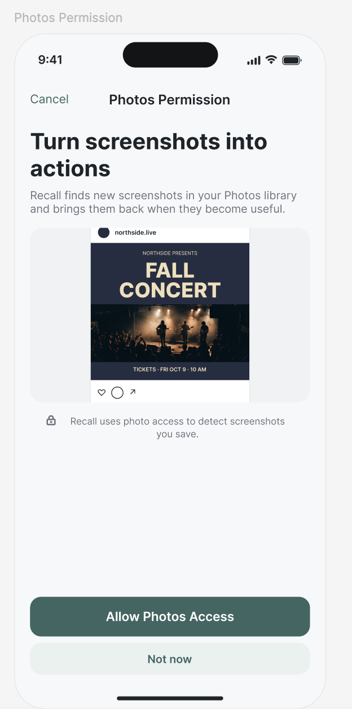
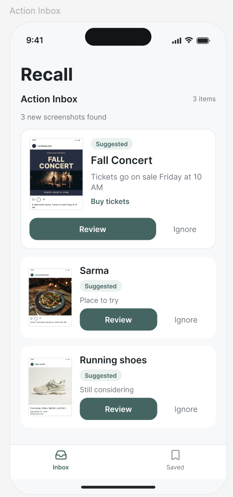
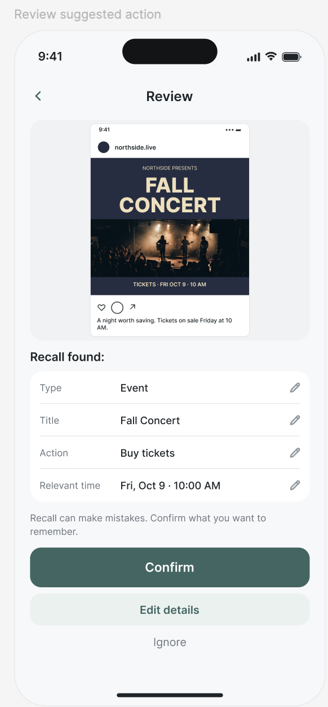
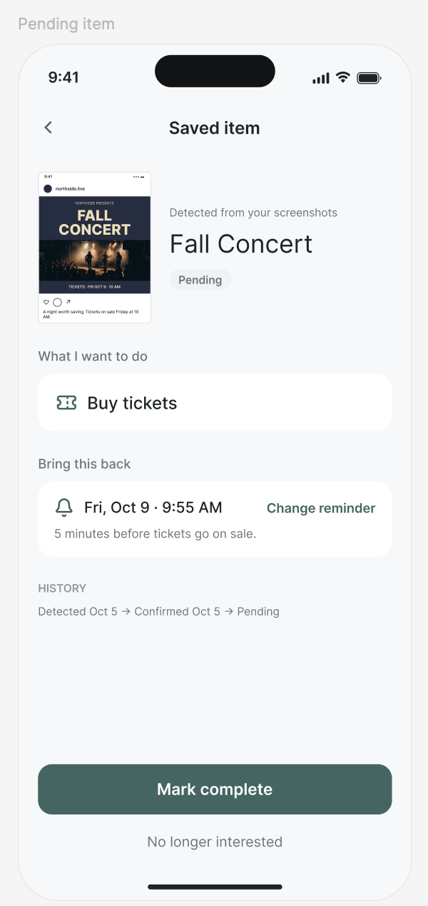
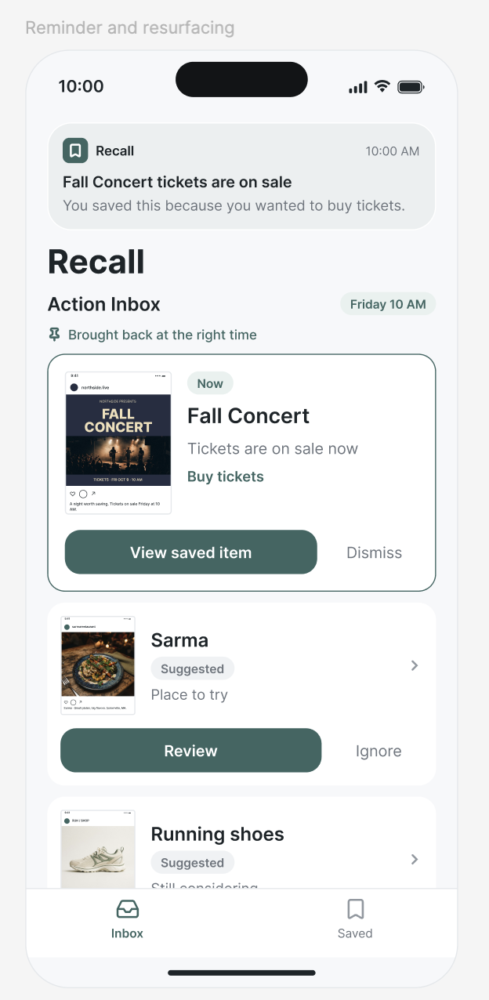
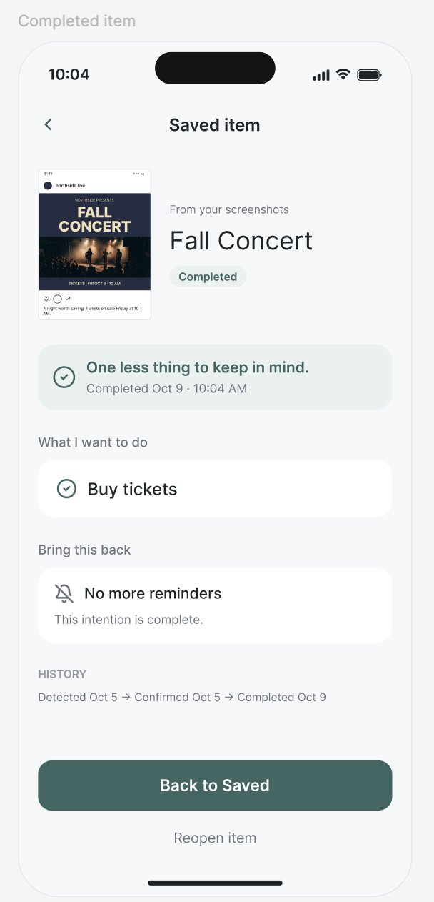

# P1: Design --- Recall

**Working name:** Recall
**Core idea:** screenshots should come back when they become useful,
not just become easier to find.

## Problem Framing and Stakeholders

### Domain

People use screenshots as an easy way to save things they
encounter on their phones. A screenshot might capture a restaurant they
want to try, a product they are considering, an event they want to
attend, or information they expect to need later. The appeal is that
saving requires almost no interruption: the user does not need to decide
where the information belongs, open another app, or enter structured
information.

The problem is that the screenshot preserves what appeared on the screen
but usually loses why the person saved it. A concert screenshot may mean
"buy tickets when they go on sale." A restaurant screenshot may mean
"remember this the next time we are choosing where to eat." A product
screenshot may mean "I am considering buying this, but not today." All
three are stored in nearly the same way even though the user's intended
future actions are different.

As screenshots accumulate, the burden shifts back to the user. They must
remember that the screenshot exists, remember approximately what it
contained, find it again, reconstruct why they saved it, and then take
the intended action. The screenshot is therefore effective at capturing
information in the moment but weak at carrying intent forward through
time.

### Bad Situations

#### 1. A time-sensitive action is missed

A student sees an Instagram post for a concert while walking to class.
Tickets go on sale Friday morning. She wants to go, but she does not
want to stop walking, open her calendar, copy the sale time, and create
a reminder, so she takes a screenshot.

During the next few days she takes more screenshots and the concert
moves farther back in her camera roll. Friday arrives, but nothing
connects the saved screenshot to the fact that it has become relevant.
She remembers several days later, finds the screenshot, and discovers
that the inexpensive tickets are gone.

The failure is not that she could not find the screenshot eventually.
The failure is that the information mattered at a particular time and
the screenshot did nothing when that time arrived.

#### 2. A saved option is forgotten at the moment of a decision

Two friends are deciding where to eat. One of them remembers seeing
several restaurants on Instagram during the previous month and
screenshotting them. He knows that one looked especially good but cannot
remember its name. He searches his photos, but the screenshots are mixed
with conversations, receipts, memes, and other saved content. After a
few minutes, they give up and choose a familiar restaurant.

A week later he encounters the screenshot while looking for something
unrelated. The restaurant was successfully saved, but it was unavailable
when the decision it was meant to inform actually happened.

#### 3. An unresolved intention becomes indistinguishable from old information

A user screenshots a pair of shoes because she may want to buy them
after thinking about the price. Over the following weeks she screenshots
other products. Some she later buys, some she decides against, and some
remain genuine possibilities. Her camera roll does not record these
changes.

When she later reviews the screenshots, she must reconsider items she
has already resolved because "bought," "not interested," and "still
considering" all look identical. The collection grows without a notion
of what still deserves attention.

These situations share the same underlying problem: screenshots are good
at capturing something now, but poor at representing an intention that
changes or becomes relevant later.

### Corroboration

My original framing was motivated by my own behavior, especially
screenshotting food deals and other things I intend to revisit. Online
discussions provide additional evidence that screenshot accumulation is
not unusual. In the Reddit discussion used in Exercise 1, one user
described using screenshots for nearly everything they wanted to save
and later having to search through hundreds of similar images; the user
reported that they and their spouse had accumulated roughly 40,000
screenshots. Other participants described collections of more than 1,000
screenshots spanning recipes, conversations, directions, products,
events, and other things they wanted to revisit.

The existence of screenshot-management applications also suggests that
retrieval and organization are recurring problems rather than isolated
behavior. Existing products increasingly make screenshots searchable or
categorize them automatically. That addresses one part of the problem,
but the bad situations above show a separate failure: even a perfectly
searchable screenshot can still be forgotten until after the moment when
it mattered.

This project focuses on that second problem: preserving the user's
intended future relationship with saved information.

### Workarounds and Comparables

The simplest workaround is to search the camera roll when a screenshot
is needed. Modern photo applications can search visible text and image
content, which is useful when the user remembers what they are looking
for. Users can also manually organize screenshots into albums.

A stronger workaround is to immediately transfer the information into
the application that matches the intention: create a calendar event for
a concert, save a restaurant to a map, create a reminder, or add a
product to a shopping list. This can work well, but it removes the main
advantage of screenshotting. At the moment of discovery, the user must
stop, decide what the information means, choose another application, and
enter the relevant details.

Screenshot-management applications such as Stash focus on organizing,
categorizing, and retrieving screenshots. These tools are useful
comparables because they reduce the cost of finding something later. The
gap I want to explore is what happens after retrieval: a searchable
concert screenshot is still passive if nothing brings it back when
tickets become available, and a searchable restaurant screenshot still
does not distinguish a place the user still wants to try from one they
already visited.

### Solution Sketch

I would build a system that treats a screenshot as the beginning of a
small lifecycle rather than the end of a capture action. The user
continues taking screenshots because that is the low-friction behavior
that already works. The application interprets a new screenshot and
proposes what it may represent: for example, an event with a relevant
date, a place to try, or a product being considered.

The user can quickly confirm, edit, or ignore that interpretation. Once
confirmed, the saved item can remain pending, become relevant at a
particular time, be completed, or be dismissed. A concert might progress
from saved to pending to completed after tickets are bought. A
restaurant can remain pending until the user visits it or loses
interest.

For the first version, the system is deliberately limited to events,
places, and products. It does not need to purchase tickets, make
restaurant reservations, or complete purchases itself. Its job is to
preserve the intent behind a screenshot and return the right saved item
to the user's attention at a useful moment.

### Stakeholders

**Screenshot saver.** The primary stakeholder is a person who uses
screenshots to quickly save things for later and currently bears the
cost of remembering, finding, and interpreting those screenshots.

**People making decisions with the saver.** Friends, partners, or family
members may indirectly benefit when a saved restaurant, event, or
product becomes available during a shared decision, although they do not
need to use the application themselves.

**Creators and businesses represented in screenshots.** Restaurants,
event organizers, stores, and creators may benefit when a user's earlier
interest turns into an eventual action, but they do not control the
user's saved items or receive the user's screenshot data through the
core design.

------------------------------------------------------------------------

## Application Pitch

### Recall

**Motivation:** People screenshot things because saving them is
effortless, but the intention behind the screenshot is easy to forget
before it becomes useful.

**Recall** turns screenshots from passive images into lightweight things
to follow up on. You keep taking screenshots exactly as you do now.
Recall interprets a new screenshot and proposes the reason it may have
been saved. The user remains in control: one quick confirmation can turn
the screenshot into something the app knows is still pending.

**Action Inbox.** New screenshots that appear actionable are collected
with a proposed interpretation such as "buy tickets Friday," "restaurant
to try," or "product to consider." Instead of requiring the user to
organize every screenshot manually, Recall asks only for a quick
confirm, edit, or ignore. This preserves the low-friction reason people
screenshot in the first place.

**Bring It Back at the Right Time.** A saved item can have a relevant
time. If a screenshot says that concert tickets go on sale Friday at 10
AM, Recall can bring that item back then. The feature addresses the
time-sensitive bad situation: the user no longer has to remember that a
useful screenshot is buried in the camera roll.

**Resolve What You Saved.** Saved items have a lifecycle. They can
remain pending, be completed, or be dismissed when the user is no longer
interested. This means the app represents whether an intention is still
alive rather than allowing completed and unresolved screenshots to
accumulate together forever.

Recall intentionally stops short of buying products, booking
restaurants, or purchasing tickets. Those actions would depend on many
external services and would expand the project beyond its core value.
The first version instead solves one focused problem: carrying the
user's intention from the moment of capture to the moment when it can
actually be acted on.

------------------------------------------------------------------------

## Concept Design

### Concept 1: Collecting

``` text
concept Collecting [User, Item]

purpose
  maintain items discovered for a user without requiring the user to organize them manually

principle
  after an item is added to a user's collection, it remains there until it is removed

state
  a set of Collections with
    an owner User
    an item Item
    a collectedAt DateTime

actions
  add (user: User, item: Item, collectedAt: DateTime): (collection: Collection)
    where no collection exists for this user and item
    then create a collection with owner user, item item, and collectedAt collectedAt
    return collection

  remove (user: User, collection: Collection)
    where collection exists and user is its owner
    then remove collection
```

In Recall, `Item` is a reference to a screenshot found in the user's
Photos library. Photos access and detection are supporting
functionality: when a new screenshot is detected, the application
invokes `Collecting.add`. The concept itself only represents which
discovered items Recall maintains for a user.

### Concept 2: Interpreting

``` text
concept Interpreting [Item]

purpose
  let uncertain interpretations of items be proposed and corrected before they are relied upon

principle
  an interpretation can be proposed for an item; a user can confirm it, replace it with a corrected
  interpretation, or reject it so uncertain machine output does not silently become accepted fact

state
  a set of Interpretations with
    an item Item
    a kind String
    a summary String
    an optional relevantAt DateTime
    a status String

actions
  propose (
    item: Item,
    kind: String,
    summary: String,
    relevantAt?: DateTime
  ): (interpretation: Interpretation)
    then create a new interpretation for item with the given values and status "proposed"
    return interpretation

  confirm (interpretation: Interpretation)
    where interpretation exists and its status is "proposed"
    then set its status to "confirmed"

  revise (
    interpretation: Interpretation,
    kind: String,
    summary: String,
    relevantAt?: DateTime
  )
    where interpretation exists and its status is "proposed"
    then replace its kind, summary, and relevantAt with the given values

  reject (interpretation: Interpretation)
    where interpretation exists and its status is "proposed"
    then set its status to "rejected"
```

The generic `Item` will be instantiated with `Collection` from
`Collecting`. The concept is intentionally generic: it could interpret
any item, not only a screenshot.

### Concept 3: Tracking

``` text
concept Tracking [User, Item]

purpose
  distinguish unresolved intentions from ones that have already been resolved

principle
  a user can begin tracking an item that still deserves attention and later complete or dismiss it;
  asking for pending items returns only intentions that remain unresolved

state
  a set of Trackings with
    an owner User
    an item Item
    a status String

actions
  track (user: User, item: Item): (tracking: Tracking)
    where no active tracking exists for this user and item
    then create a tracking with owner user, item item, and status "pending"
    return tracking

  complete (user: User, tracking: Tracking)
    where tracking exists, user is its owner, and status is "pending"
    then set status to "completed"

  dismiss (user: User, tracking: Tracking)
    where tracking exists, user is its owner, and status is "pending"
    then set status to "dismissed"
```

The generic `Item` will be instantiated with confirmed `Interpretation`
individuals. Tracking deliberately knows nothing about screenshots,
events, restaurants, or products.

### Concept 4: Reminding

``` text
concept Reminding [User, Item]

purpose
  return an item to a user's attention at a chosen future time

principle
  if a reminder is scheduled for an item, when its time arrives the reminder becomes due so the
  item can be brought back to the user's attention

state
  a set of Reminders with
    an owner User
    an item Item
    an at DateTime
    a status String

actions
  schedule (
    user: User,
    item: Item,
    at: DateTime
  ): (reminder: Reminder)
    then create a reminder with owner user, item item, at at, and status "scheduled"
    return reminder

  reschedule (
    user: User,
    reminder: Reminder,
    at: DateTime
  )
    where reminder exists, user is its owner, and status is "scheduled"
    then set reminder's at to at

  cancel (user: User, reminder: Reminder)
    where reminder exists and user is its owner
    then set status to "cancelled"

  due (reminder: Reminder)
    where reminder exists, status is "scheduled", and its at time has arrived
    then set status to "due"

  acknowledge (user: User, reminder: Reminder)
    where reminder exists, user is its owner, and status is "due"
    then set status to "acknowledged"
```

The generic `Item` will be instantiated with `Tracking` individuals.
Reminding therefore operates on anything being tracked without needing
to know what that thing represents.

### Essential Reactions

#### 1. Interpret a newly collected screenshot

``` text
when Collecting.add (user, item, collectedAt): (collection)
then Interpreting.propose (
  item: collection,
  kind: inferredKind(item),
  summary: inferredSummary(item),
  relevantAt: inferredRelevantTime(item)
)
```

The Photos integration supplies the screenshot reference when it detects
a new screenshot. The `inferred...` values come from the application's
recognition mechanism, so neither concept depends on the implementation
of Photos access, OCR, or AI.

#### 2. Begin tracking a confirmed interpretation

``` text
when Interpreting.confirm (interpretation)
then Tracking.track (userFor(interpretation), interpretation)
```

The application composition maintains the association needed to identify
the user whose capture produced the interpretation. This information is
not assumed to be a property of the interpretation inside `Tracking`.

#### 3. Schedule a reminder when a confirmed interpretation has a relevant time

``` text
when Interpreting.confirm (interpretation)
where interpretation has a proposed relevant time
then Reminding.schedule (
  userFor(interpretation),
  trackingFor(interpretation),
  relevantTimeFor(interpretation)
)
```

This reaction connects interpretation, tracking, and reminding while
keeping the concepts themselves independent.

#### 4. Surface an item when its reminder becomes due

``` text
when Reminding.due (reminder)
then show trackingFor(reminder) in the user's Action Inbox
```

In implementation, the final step is a UI effect rather than another
domain concept. The essential design point is that time causes an
already-saved intention to reappear.

#### 5. Stop future reminders when an intention is resolved

``` text
when Tracking.complete (user, tracking)
then Reminding.cancel (user, reminderFor(tracking))

when Tracking.dismiss (user, tracking)
then Reminding.cancel (user, reminderFor(tracking))
```

These are separate reactions because completion and dismissal are
independent ways of resolving a tracking.

### Role of the Concepts

The concepts separate four behaviors that could otherwise become one
screenshot-specific data structure. `Collecting` maintains automatically
discovered items without requiring manual organization. `Interpreting`
handles uncertainty and user correction. `Tracking` represents whether
an intention still deserves attention. `Reminding` handles future
relevance.

Their composition creates the application's distinctive behavior. A
collected screenshot can be interpreted without automatically being
trusted; a confirmed interpretation can be tracked without needing a
reminder; and tracking can be completed without knowing why the item was
originally saved. This also keeps AI recognition outside the conceptual
core. If the recognition implementation changes, the behavior of
confirming, tracking, completing, and reminding does not need to change.

The generic types are instantiated as follows:

-   `Collecting.Item` → screenshot reference from Photos
-   `Interpreting.Item` → `Collecting.Collection`
-   `Tracking.Item` → `Interpreting.Interpretation`
-   `Reminding.Item` → `Tracking.Tracking`

The `User` type is the application's user identity. Authentication is
omitted from the concept set because it is standard supporting
functionality rather than a behavior that differentiates this
application.

------------------------------------------------------------------------

## UI Sketches

### Sketch 1 --- Photos Permission



Photos access is granted once during setup. After that, Recall
automatically detects new screenshots; there is no recurring import or
add-screenshot step. The user can also skip access for now.

### Sketch 2 --- Action Inbox



The inbox is not meant to reproduce the entire camera roll. It shows
screenshots for which the application has proposed or is tracking an
action. The primary interactions are deliberately small: review the
proposed action or ignore it.

### Sketch 3 --- Review a Suggested Action



Recognition is treated as a suggestion rather than truth. Before a
proposed interpretation becomes something Recall relies on, the user can
confirm or correct the type, title, action, and relevant time. This
makes the design useful even when recognition is imperfect.

### Sketch 4 --- Pending Saved Item



A saved item exposes the key state missing from a camera roll: whether
the intention is still pending. A user can complete it, dismiss it, or
change when it should return to their attention.

### Sketch 5 --- Reminder



When a relevant time arrives, the saved item returns to the Action Inbox
and a notification explains why it was saved. The user can open the
saved item or dismiss the reminder.

### Sketch 6 --- Completed Item



Marking an item complete records that the intention is resolved and
stops further reminders. The history remains visible, and the user can
reopen the item if it is not actually finished.

## User Journey

Maya is walking to class when she sees an Instagram post announcing a
concert she wants to attend. Tickets go on sale Friday at 10 AM. She
does not want to stop and enter the information into another
application, so she does what she already does: she takes a screenshot.

Because Maya previously granted Recall access to screenshots in Photos
(**Photos Permission, Sketch 1**), Recall automatically detects the
screenshot and proposes an interpretation. Later, Maya opens Recall. In
the **Action Inbox (Sketch 2)**, the screenshot is already waiting with
the suggested action "Buy tickets" and the relevant time Friday at 10
AM. She opens it and reaches **Review Suggested Action (Sketch 3)**. The
concert and sale time were interpreted correctly, so she confirms the
suggestion. The item is now pending (**Pending Saved Item, Sketch 4**),
and Recall schedules it to return to her attention when the sale becomes
relevant.

On Friday morning, the saved item returns to Maya's Action Inbox
(**Reminder, Sketch 5**). Instead of needing to remember that she took a
screenshot several days earlier, she sees the concert when there is
something she can actually do about it. She buys the tickets and marks
the intention complete. The saved item then shows as resolved
(**Completed Item, Sketch 6**).

The screenshot itself was never the real goal. Maya's goal was to buy
tickets later without interrupting what she was doing when she first
discovered the concert. Recall preserves that intention across the gap
between those two moments.

